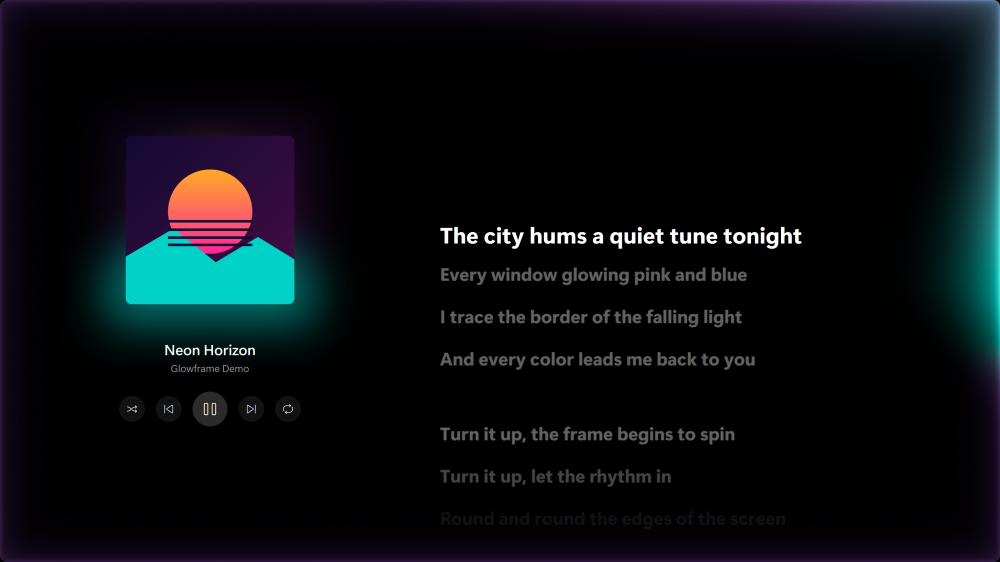

# Glowframe

A native Windows fullscreen "now playing" mode for Spotify: a glowing comet in
your cover's colors travels around the edge of the screen and pulses to the
beat, with a player view, a large cover view and line-synced lyrics.



*Demo mode with a self-made cover and lyrics.*

## Features

- **Glowing frame:** a comet of light travels clockwise around the screen
  border in the colors of the current cover and pulses with the beat. Covers
  with several dominant colors get one comet per color.
- **Beat detection:** analyzes only Spotify's audio (Windows process loopback),
  so system sounds, Discord etc. do not trigger it.
- **Player view:** cover, title, artist and controls (shuffle, previous,
  play/pause, next, repeat).
- **Clock:** date and time at the top in a lock screen style (can be turned off)
- **Lyrics focus view:** large cover on the left, lyrics on the right; while
  idle, it or the cover view is picked at random, then they alternate every
  few minutes
- **Lyrics styles (keys 1–9):** **1** classic, **2** messages – a chat thread
  where message bubbles pop in line by line, words light up as they are sung
  and lines that mention a place appear as a small map card – **3**
  constellation, where the words of each line appear as stars connected one
  after another, **4** constellation V2, one continuous chain of up to 30
  words across lines with keywords drawn larger, and **5** code, where the
  lyrics are typed like code in an editor while the camera follows the cursor,
  flies back to the chorus when it repeats and sometimes looks at the code
  from the side.
- **Record:** for songs without lyrics, every other song (at random) shows a
  spinning vinyl record with the cover as its label instead of the cover.
- **Backgrounds:** black, your Windows wallpaper, your own image (at least
  2560×1440) or real transparency, with adjustable dimming; optionally keep the
  taskbar visible.
- **Updates and autostart:** check for and install new versions from the
  settings (also checked quietly at startup); optional start with Windows.
- **Cover view:** after a few seconds without mouse movement the cover is shown
  large, with the current lyric line underneath.
- **Synced lyrics:** line by line from [LRCLIB](https://lrclib.net), Apple
  Music style.
- **HD covers:** sharp artwork from the iTunes Search API when Spotify only
  provides a small thumbnail.
- **Smooth motion:** all transitions use spring physics.
- **Multi-monitor:** per monitor choose animation, black or untouched.
- **Lightweight:** a single ~7 MB executable, no runtimes to install, a few MB
  of RAM while idle in the tray.
- **Languages:** English and German.

## Requirements

- Windows 10 version 2004 or newer, or Windows 11 (64-bit)
- The Spotify desktop app (regular installer or Microsoft Store version)
- A graphics card with Direct3D 11 (any GPU from the last decade)
- For the settings window: an OpenGL 2.0 capable graphics driver (normal on
  any PC with GPU drivers installed)
- Internet access is optional; it is only used for lyrics and HD covers

You do **not** need a Spotify developer account or to log in anywhere:
Glowframe reads what Spotify reports to the Windows media controls.

## Installation

Download the latest version from the
[Releases page](https://github.com/CallMeFriedrich/glowframe/releases/latest).
There are two options.

### Option A: Installer (recommended)

1. Download `Glowframe-<version>-setup.exe`.
2. Run it. Glowframe installs for your user only, so **no administrator rights
   are needed**. It goes to `%LOCALAPPDATA%\Programs\Glowframe` and gets a
   Start menu entry.
3. **Windows SmartScreen** may show "Windows protected your PC" because the
   installer is not code-signed. Click **More info**, then **Run anyway**.
4. At the end, leave "Launch Glowframe" checked or start it from the Start
   menu.

Glowframe does not start with Windows automatically.

### Option B: Portable ZIP

1. Download `Glowframe-<version>-portable.zip`.
2. Extract it to any folder, for example a USB stick or `D:\Tools\Glowframe`.
3. Run `Glowframe.exe`. SmartScreen may warn as described above.

The ZIP contains a `portable.txt` file. As long as it is next to the exe,
settings, cache and logs are stored in that folder instead of your user
profile.

### Updating

Install the new version over the old one (installer) or replace
`Glowframe.exe` (portable). Settings are kept. Quit Glowframe first
(tray icon → **Quit**).

## Getting started

1. Start Spotify and play something.
2. Start Glowframe. It runs as an icon in the system tray (bottom right; it
   may be hidden behind the **^** arrow).
3. Start the fullscreen mode with **Ctrl+Alt+L**, by double-clicking the tray
   icon, or via right-click → **Start**.
4. Move the mouse to see the player and its controls. After 5 seconds without
   movement the cover view appears.
5. Press **1**, **2** or **3** to switch the lyrics style (classic, messages,
   constellation).
6. Press **Esc twice** (or Ctrl+Alt+L again) to leave the fullscreen mode.

Right-click the tray icon for **Start/Stop**, **Settings** and **Quit**.

Without Spotify running, the frame keeps glowing slowly and shows "Waiting for
Spotify …"; it continues automatically once Spotify plays.

## Settings

Open them via tray icon → **Settings**. Changes apply immediately, even while
the fullscreen mode is running, and are saved automatically.

| Section | Options |
|---|---|
| General | Language (top right), hotkey (click **Change** and press a combination with Ctrl or Alt), start with Windows, check for updates / install |
| Background | Black, Windows wallpaper, custom image (≥ 2560×1440), transparent; dimming 0–90 %; keep the taskbar visible |
| Monitors | Per monitor: **Animation** (frame and player), **Black**, or **Free** (not covered). Default: primary monitor animation, others black |
| View | Time until the cover view (2–60 s), show date and time on/off |
| Frame | Brightness, width, rotation speed, beat reaction (0 % turns the beat off), color mode (cover colors or a fixed palette: Neon Pink, Ocean, Sunset, Mono, custom colors) |
| Lyrics | On/off, in player view, in cover view, style (classic/messages/constellation), timing offset (−2000 to +2000 ms) |
| Cover | Load HD covers |

## Privacy

- **Spotify data** (title, artist, album, cover, playback state) comes from the
  Windows media controls on your PC. No Spotify login, no Spotify API.
- **Audio** is analyzed only in memory while the fullscreen mode is active,
  to detect beats. Nothing is recorded, stored or sent.
- **Network:** for lyrics, title, artist, album and duration of the current
  song are sent to [LRCLIB](https://lrclib.net). For HD covers, artist and
  album are sent to the [iTunes Search API](https://developer.apple.com/library/archive/documentation/AudioVideo/Conceptual/iTuneSearchAPI/).
  Both can be turned off in the settings (lyrics, HD covers). About 10 seconds
  after the start (and when you click "Check for updates"), Glowframe asks the
  GitHub API for the latest release; this request contains no personal data.
  Nothing else is sent anywhere; there is no telemetry.

### Where files are stored

| What | Installed version | Portable version |
|---|---|---|
| Settings | `%APPDATA%\Glowframe\settings.json` | next to `Glowframe.exe` |
| Cache (covers, lyrics) | `%LOCALAPPDATA%\Glowframe\cache` | `cache\` next to the exe |
| Logs (last 3 days) | `%LOCALAPPDATA%\Glowframe\logs` | `logs\` next to the exe |

## Uninstalling

- **Installer version:** Windows Settings → Apps → Installed apps (Windows 10:
  Apps & features) → **Glowframe** → Uninstall. You will be asked whether settings, cache and logs
  should be deleted as well.
- **Portable version:** quit Glowframe and delete its folder.

## Troubleshooting

- **No beat pulse:** check that Spotify is actually playing and that "Beat
  reaction" in the settings is above 0 %. On Windows versions without process
  loopback, Glowframe falls back to analyzing all system audio.
- **No lyrics:** LRCLIB has no synced lyrics for every song; then the player
  stays centered. Songs without a match are retried after 7 days.
- **Lyrics too early or too late:** adjust Lyrics → Advanced → Offset.
- **The hotkey does nothing:** another program uses the combination. Glowframe
  shows a notification; choose a different one in the settings.
- **The settings window does not open** (for example over Remote Desktop):
  it needs an OpenGL 2.0 graphics driver. Glowframe shows a notification with
  the path of `settings.json`, which you can edit with any text editor while
  Glowframe is not running.
- **Something else:** the log files (see above) usually say what went wrong.
  Please attach them when opening an issue.

## Building from source

Requirements: [Rust](https://rustup.rs) (stable, MSVC toolchain) and the
Visual Studio Build Tools with the "Desktop development with C++" workload and
a Windows SDK.

```powershell
git clone https://github.com/CallMeFriedrich/glowframe.git
cd glowframe
cargo build --release
.\target\release\glowframe.exe
```

To build the installer and the portable ZIP into `dist\`, install
[Inno Setup 6](https://jrsoftware.org/isinfo.php) and run:

```powershell
.\scripts\package.ps1
```

Useful command line flags for development:

| Flag | Effect |
|---|---|
| `--start` | Start the fullscreen mode immediately |
| `--demo` | Fake Spotify data with a self-made cover, lyrics and a 120 BPM beat; no Spotify needed |
| `--exit-after <seconds>` | Quit automatically, handy for tests |
| `--log-level <level>` | e.g. `debug` or `glowframe=debug` |

`cargo test` runs the unit tests. The full specification (in German) is in
[SPEC.md](SPEC.md).

## Credits

- Synced lyrics: [LRCLIB](https://lrclib.net)
- HD covers: iTunes Search API
- Built with [windows-rs](https://github.com/microsoft/windows-rs),
  [winit](https://github.com/rust-windowing/winit),
  [egui](https://github.com/emilk/egui),
  [realfft](https://github.com/HEnquist/realfft) and
  [ureq](https://github.com/algesten/ureq)

Glowframe is not affiliated with or endorsed by Spotify or Apple.

## License

[MIT](LICENSE)
